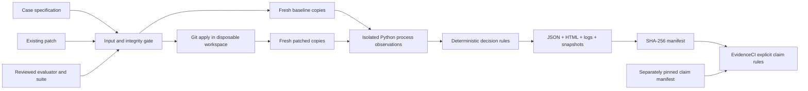

# Architecture

PatchReplay's MVP answers one bounded question: did a registered patch change
the declared bug examples from the expected failures to passes, while preserving
the declared regression behaviors? EvidenceCI then checks an explicitly
structured claim about those observations.

“Isolated Python process” refers to Python `-I`, a sanitized environment and
separate working directories. It is **not OS security isolation**.

## Components and decisions

| Component | Responsibility | Trade-off |
| --- | --- | --- |
| `contracts.py` | Strict case parsing, named statuses, pure decision function | No framework dependency; schema versions must be migrated explicitly |
| `integrity.py` | Canonical SHA-256 identities, safe relative paths, conservative diff parsing, manifests | Rejects uncommon patches, symlinks, binary files, mode changes and renames |
| `engine.py` | Admission, disposable copies, Git patching, independent check groups, packaging | Only reviewed fixtures; no arbitrary repo checkout or setup commands |
| `worker.py` | Trusted pytest adapter recording node, phase, outcome and exception type | Records instrumented observations; cannot defeat hostile Python code |
| `process.py` | Environment allowlist, process timeout, process-tree termination | No memory quota, network boundary, or filesystem isolation |
| `claims.py` | Artifact anchoring, report consistency, exact scope, arithmetic and drift | Explicit rules only; no general natural-language truth judgment |
| `reporting.py` | Escaped static HTML with details and raw links | No backend, JavaScript, fonts, analytics or CDN |

The only direct runtime dependency is pytest 8.3.5. The repository lock pins its
transitive dependencies. Python's standard library handles CLI parsing, hashes,
JSON, subprocesses and HTML. Git applies unified diffs without a shell. There is
no database, API service, agent framework, result cache or paid API dependency.

## Admission and immutable criteria

The installed catalog is part of the trusted project release. Source trees and
the evaluator have separately registered hashes. Patches are both structurally
checked and allowlisted by their complete bytes. A patch may only touch
`clamp.py`; repository tests and all evaluator files are protected. Suite members
pin source, patch, evaluator, repetitions, timeout and pytest version. Changing
those inputs requires a reviewed suite version. Titles and patch locations do
not change which code can execute, but still affect the recorded case identity.

The authoring script is not an approval engine. Running it on attacker-provided
code would undermine the trust boundary. A maintainer must review source and
fixture changes as executable code before admitting them.

The evaluator is copied outside the patchable source. Each of four phases per
attempt receives fresh source and evaluator copies, so tests cannot pass by
leaking in-process state across phases. All source/evaluator/worker files are
hashed again after each invocation; detected mutation fails integrity. Each
invocation loads only the declared nodes, disables plugin autoload, ignores
conftest files, and uses its own pytest configuration.

Git patch validation/application is performed before starting the check matrix.
Baseline checks always use an untouched snapshot, so the logical before/after
comparison is independent of operation order. The source working tree is never
checked out, cleaned, reset, or patched. Temporary Git repositories have no
commits, remote or push operation.

## Identity and replay

Fixture source revisions are `sha256:<canonical tree hash>`, explicitly not Git
commit IDs. A tree identity hashes a sorted mapping of relative path to byte
SHA-256. On export/checkout, LF preservation matters. `.gitattributes` pins text
files to LF so fixture identities survive Windows clones. Installer-generated
`__pycache__` directories are excluded from fixture identities and never copied
into executed snapshots; sealed evidence still hashes every file without exclusions.
Generated JSON always uses LF. The checked-in evidence directory has `-text`
attributes so Git preserves raw platform log bytes rather than normalizing them.

The aggregate `inputs_sha256` hashes source revision, patch, evaluator, suite,
case, environment and engine identities. Engine identity hashes the shipped
Python modules and HTML template. The package contains a copy of these engine
files. Environment identity includes Python version/implementation, OS build,
architecture, installed distribution versions, Git version, and executor policy.
Absolute execution paths are recorded in argv but are not environment identity.

Replay first checks all artifacts and decision consistency. It then requires
the same engine and environment fingerprints and re-admits the saved case and
patch against the installed catalog. A replay creates a different run ID with
the same input identity. It does not reuse results or promise identical timing
or outcomes. Hardware, scheduling, OS state and external effects are not captured.

## Failure boundaries

Failures that occur after a case is parsed and admitted far enough to allocate
a package produce JSON and HTML, including environment preflight failures.
Malformed JSON, unknown cases, missing input files and unwritable output paths
are CLI input/operation failures (exit 2). An interrupted process or full disk
can leave an unsealed package; EvidenceCI rejects it as missing evidence.

## Upstream references

Implementation uses the installed, pinned pytest version and official
[pytest exit-code documentation](https://docs.pytest.org/en/stable/reference/exit-codes.html),
[pytest invocation documentation](https://docs.pytest.org/en/stable/how-to/usage.html),
[Python subprocess documentation](https://docs.python.org/3.12/library/subprocess.html),
and [Git apply documentation](https://git-scm.com/docs/git-apply).
Future upstream exit codes are never silently interpreted as success.
Windows lifecycle handling follows Microsoft's
[Job Objects documentation](https://learn.microsoft.com/en-us/windows/win32/procthread/job-objects).
